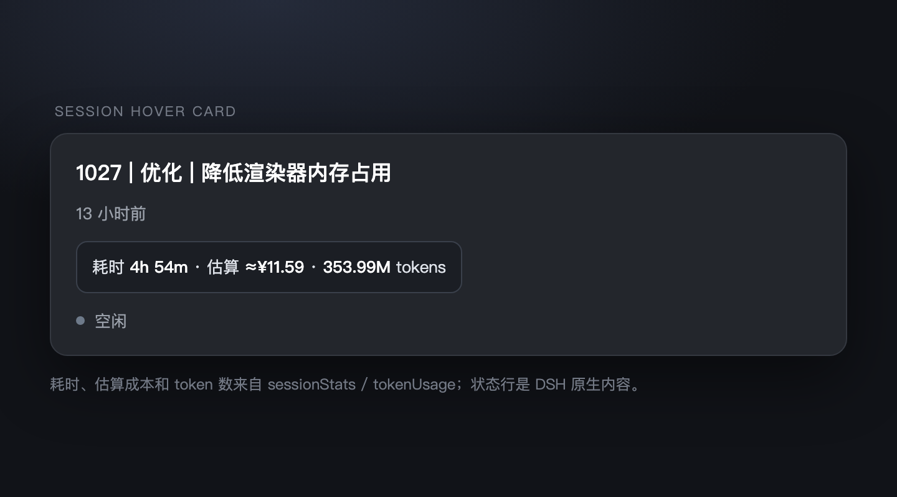
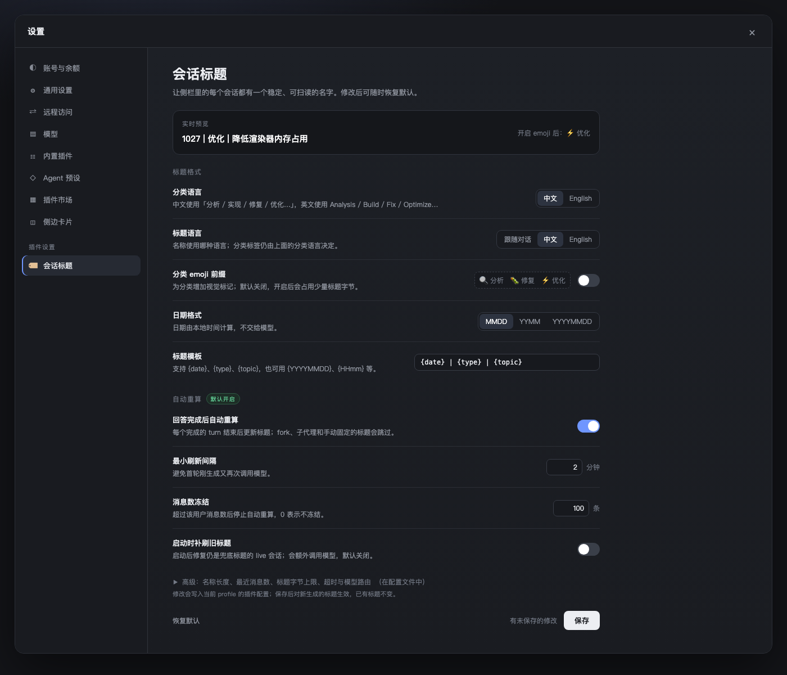

# dsh-session-title-stamp

[](https://www.npmjs.com/package/dsh-session-title-stamp)
[](./LICENSE)
[](https://github.com/deepseek-ai/deepseek-harness)

English | [中文](./README.zh.md)

A DeepSeek Harness title provider for a configurable `DATE | CATEGORY | NAME`
title. Beyond automatic naming:

- **Auto refresh** — after a completed turn, with a 2-minute cooldown and a
  100-message freeze; forks and user-pinned titles are skipped.
- **Generate title** — the conversation-header ↻ button, the session row's
  **Generate title** menu item, or `/retitle`.
- **Copy title** — an extra item in the session `···` menu copies the full title.
- **Settings page** — preview and change format, emoji, title language, and refresh cadence without editing YAML.
- **Optional category emoji** — `categoryEmoji: true` renders titles such as
  `1027 | ⚡ 优化 | ...`.
- **Hover stats** — see duration, estimated CNY cost, and token count at a glance,
  without opening a dashboard.
- **Category language** — `categoryPreset: zh | en`, or your own `categories`.
- **Title language** — names can follow the conversation, or be forced to Chinese/English.
- **Failure-safe** — a failed retitle keeps the current title.
- **Zero build** — pure Host logic plus a small hand-written browser half.

> **The title tells you what the session was about; the hover card tells you what it cost.**
> Duration, estimated CNY, and tokens are one hover away — no dashboard.

Default format:

```text
DATE | CATEGORY | NAME
```

For example, with `categoryPreset: en`:

```text
1028 | Analysis | Short-drama platform verification
1027 | Fix | Four-device acceptance rework
1026 | Release | Ubuntu environment setup
1025 | Optimize | Reduce memory usage in the renderer
```

Dates are computed by the plugin from the session's creation time, never by the
model. Categories are chosen from a small configurable taxonomy and validated
locally. The model only proposes the category and the name; the provider owns
the final format. The default taxonomy is Chinese; set `categoryPreset: en` for
the English labels above.

## Why

Long-lived workspaces collect dozens of sessions whose titles are either the
first few words of the first message or an auto-summary that drifts. A fixed
`date | category | name` convention makes the sidebar scannable across projects,
and mirrors conventions used by other coding agents.

## Requirements

- DeepSeek Harness `>=0.2.1-rc.3 <0.3.0`.
- A working model route for the session; the title request uses the session's
  current provider/model unless `provider`/`model` are configured.

## Install

### DSH Desktop / Web with Discover

Add this market index source in **Plugins → Discover → Index sources**:

```text
https://cdn.jsdelivr.net/gh/xuedipiaofei/dsh-session-title-stamp@v0.8.0/market/index.json
```

Then install **Session title stamp** from the list. The plugin installs as a
profile bundle and appears in the Plugins page, where it can be enabled or
disabled like any other bundle.

### CLI

From GitHub:

```sh
dsh plugin --profile <profile> add github:xuedipiaofei/dsh-session-title-stamp
```

From npm:

```sh
dsh plugin --profile <profile> add dsh-session-title-stamp
```

For a local checkout:

```sh
dsh plugin --profile <profile> add ./dsh-session-title-stamp
```

The Electron Desktop profile is managed by the application; use its Plugins
page rather than `dsh plugin --profile desktop`.

The bundle patch disables the shipped `session-title-llm` row and inserts this
provider. Do not enable the official
`@deepseek-ai/dsh-experimental-session-titles-bundle` at the same time: both
replace the same provider slot, and the title service accepts only one provider.
If another provider wins the registration race, this plugin logs a warning and
stays inactive instead of failing startup.

## How it works

- `cordis.patch.yml` disables `session-title-llm` and inserts the
  `session-title-stamp` row from this package.
- `lib/index.js` registers a provider through `ctx.sessionTitle.register()` and
  reuses `@deepseek-ai/dsh-session-title-llm` for route selection, timeouts,
  cancellation, token limits, and exact auxiliary-request logging.
- `lib/format.js` is dependency-free: local-time date parts, template rendering,
  category validation, name sanitizing, and UTF-8 byte truncation.

The provider computes the date from `session.header.createdAt` in the host's
local time zone, asks the model for `{"category":"...","name":"..."}`, validates
the category, and renders the template. Empty `{type}` or `{topic}` segments
remove their neighbouring separator instead of leaving `||`.

### Retitle cadence

The provider is registered as `first-prompt`, so the title service names the
session once. After that, the plugin refreshes on a completed turn (`turn/end`)
with two guards:

- **cooldown** — at most one automatic refresh every `refreshMinIntervalMs`
  (default 2 minutes), so a fast first answer does not generate twice;
- **freeze** — after `refreshMaxTurns` user messages (default 100), automatic
  refresh stops; long sessions rarely change their main topic. `/retitle`
  still works.

Forks and subagent sessions are skipped, as are titles pinned by a manual
rename. Setting `refreshOnTurnEnd: false` restores the legacy message-count
mode using `retitleEvery`.

### Header button and hover stats

0.7.0 adds a small browser half:

- a **refresh icon** in the conversation header; it runs the same `/retitle`
  command as typing it, and is disabled while the session is running.



- a **hover-card line** under the native relative time, for example
  `Duration 1h 51m · est. ≈¥4.11 · 131.7M tokens`;
- a **Generate title** item at the top of the session row's `···` menu, plus a
  **Copy title** item below the native Copy Session ID. Neither adds a dialog.

The hover line is derived from the `sessionStats` and `tokenUsage` projections,
priced with the current DeepSeek CNY rate table, and labelled as an estimate.
It is fetched from the host only when the hover card opens; a session that was
never loaded is not resumed just to show the numbers. Native DSH already shows
running / pending / completed-unread status (spinner, warning dot, idle line),
so this plugin does **not** add a second status-color layer.

#### Hover-card field guide

| Field | Meaning |
|---|---|
| `Duration 1h 51m` | Cumulative model + tool execution time from `sessionStats`; not wall-clock elapsed time |
| `est. ≈¥4.11` | `tokenUsage` × the current DeepSeek CNY rate table; a rough estimate, not an invoice |
| `131.7M tokens` | Input, output, cache-read and cache-write tokens combined |
| `Idle` / scheduled-task line | Native DSH status content; this plugin does not add or replace it |

Mixed-model sessions are estimated with the session's last-used model, so the
cost can differ from the actual bill. The line is intentionally omitted when the
host has no stats for that session.

If the hover line is missing, the browser half could not reach the host stats
route; the refresh button and automatic titles are unaffected.

### Settings page



0.7.0 adds **Settings → Plugins → Session titles**:

- a live preview of the exact title the current template will produce;
- category language (Chinese/English), title language, optional category emoji,
  date format, and the title template;
- the auto-refresh switch, minimum interval, message freeze, and opt-in startup
  backfill, with the cost trade-off stated in place;
- advanced name-length, recent-message, and title-byte controls; timeouts,
  budgets, and model routing stay in the profile configuration.

0.8.0 adds the title-language choice and the advanced byte limit.

Saving writes the current profile's plugin config, so it applies to the next
generated title without a restart. Existing titles are never rewritten.

### Failures

- A failed retitle **keeps the existing title**: the provider throws, which is
  the title service's signal to retain the previous revision.
- Only a session with no title yet gets a local fallback: date, an inferred
  category, and the first message's leading words.
- A `max-tokens` finish is still parsed when it contains usable text; only an
  unusable response counts as a failure.

## Configuration

Override the row in the profile's `cordis.patch.yml`:

```yaml
- id: session-title-stamp
  config:
    refreshOnTurnEnd: true
    refreshMinIntervalMs: 120000
    refreshMaxTurns: 100
    categoryPreset: zh
    template: '{date} | {type} | {topic}'
    timeZone: Asia/Shanghai
    maxNameChars: 20
```

| Field | Default | Meaning |
|---|---|---|
| `refreshOnTurnEnd` | `true` | Refresh after a completed turn; `false` falls back to `retitleEvery` |
| `refreshMinIntervalMs` | `120000` | Minimum gap between automatic refreshes; `0` disables the cooldown |
| `refreshMaxTurns` | `100` | Stop automatic refresh after this many user messages; `0` = no freeze |
| `retitleEvery` | `10` | Legacy message-count cadence, used only when `refreshOnTurnEnd: false` |
| `backfillOnStart` | `false` | On startup, refresh live sessions whose title is still the fallback |
| `backfillMaxSessions` | `30` | Maximum sessions in one backfill pass |
| `backfillIntervalMs` | `2000` | Delay between backfill refreshes |
| `template` | `{date} \| {type} \| {topic}` | Title template; see the placeholders below |
| `dateFormat` | `MMDD` | Used by `{date}`: `MMDD` (`1028`), `YYMM` (`2610`), or `YYYYMMDD` |
| `timeZone` | host local | IANA zone used for date/time placeholders |
| `categoryPreset` | `zh` | Built-in category language: `zh` or `en` |
| `titleLanguage` | `auto` | Name language: `auto`, `zh`, or `en` |
| `categories` | preset | Explicit category list; overrides `categoryPreset` |
| `categoryEmoji` | `false` | Prefix the category with its emoji (⚡ 优化, 🐛 修复, ...) |
| `maxNameChars` | `20` | Character cap before the byte cap applies |
| `maxTitleBytes` | service cap (`80`) | Effective cap is the smaller of this and `session-title`'s cap |
| `recentMessages` | `8` | First message plus this many recent messages are sent |
| `maxInputBytes` | `4096` | Input budget for one title request |
| `maxOutputTokens` | `4096` | Output cap, including reasoning tokens |
| `timeoutMs` | `90000` | End-to-end title-request deadline |
| `provider` / `model` | session route | Optional pair to route title generation independently |

### Template placeholders

| Placeholder | Meaning |
|---|---|
| `{date}` | Date in `dateFormat` (`1028`, `2610`, `20261028`) |
| `{YYYY}` `{YY}` `{MM}` `{DD}` `{HH}` `{mm}` `{ss}` | Date/time parts; concatenate freely (`{YYYYMMDD}`, `{HHmm}`) |
| `{type}` | Category; an empty value removes the segment and its separator |
| `{topic}` | Name; an empty value removes the segment and its separator |

An unknown placeholder is left verbatim (`{MMDD} {bogus}` keeps `{bogus}`), so a
typo is visible instead of silently disappearing. The template owns the final
format; `maxTitleBytes` still clips the result.

The Settings page covers the common fields; the YAML table below remains the
automation/advanced source. The default taxonomy is Chinese. `categoryPreset: en` switches it to
`Analysis / Build / Fix / Optimize / Debug / QA / Release / Docs / Other`; `categories`
overrides either preset with any labels you want. The prompt lists the configured
labels and the local fallback maps common keywords onto them.

## Privacy and cost

- The first eligible user message plus up to `recentMessages - 1` recent
  messages are sent to the model. Message text is framed as JSON to keep user
  content from breaking delimiters.
- The request uses the session's configured provider/model, or the optional
  `provider`/`model` override. The plugin makes no other network calls and
  collects no telemetry.
- One auxiliary request is made for the first title, then at most one per
  completed turn inside the cooldown, and none after the freeze threshold.
  Title work is asynchronous and never delays the main agent response;
  `maxOutputTokens`, `maxInputBytes`, and `timeoutMs` bound it.
- The resulting title is stored in the session log as a normal `session/title`
  event. A manual rename pins the title and later automatic revisions do not
  overwrite it.

## Compatibility notes

- This package targets the DSH 0.2 line. `engines.dsh` refuses to install it on
  0.3+ until it is updated against the new title API.
- The bundle assumes the shipped row id `session-title-llm`. If another title
  provider is registered first, this plugin logs and stays inactive; disable the
  other provider and reload.
- `llm`, `commands`, `sessions`, `sessionProjections`, and `connection` are
  awaited lazily; a composition without one still loads the plugin and degrades
  only the affected feature.
- The browser half needs the Web composition's `sidebar.session.row.hover` and
  `conversation.session.header.actions` seats. A shell that does not expose them
  simply shows no button/hover line.
- The provider imports `@deepseek-ai/dsh-session-title-llm` dynamically. A
  missing or incompatible executor degrades to local naming, but a changed
  `ctx.sessionTitle` API can prevent registration. Pin the DSH range when
  publishing a release.

## Development

The repository has no runtime or build dependencies.

```sh
npm test               # format tests, provider tests with a stubbed executor, metadata/index checks
npm run validate:index # optional: validate market/index.json with the official validator if installed
npm run pack:check     # inspect the npm tarball contents
```

The provider test redirects `@deepseek-ai/dsh-session-title-llm` to
`test/support/stub-executor.mjs` with Node's `module.registerHooks`, so it
exercises the real provider without a DSH install or model credentials.

Release steps are in [PUBLISHING.md](./PUBLISHING.md).

## License

MIT © 2026 xuedipiaofei
